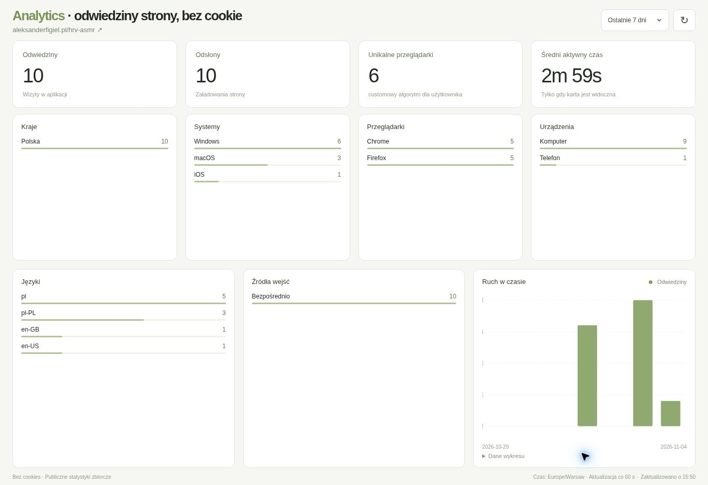

# Analytics without cookie

A lightweight analytics dashboard presenting cookie-free website statistics. This public repository contains only the ready-to-serve dashboard distribution and its showcase documentation.

**[Open the live dashboard](https://analytics-without-cookie.github.io/)**

**Backend:** [analytics-without-cookie-backend](https://github.com/analytics-without-cookie/analytics-without-cookie-backend) - private repository; access is restricted to authorized collaborators.

HRV ASMR is the first example integration. The dashboard is intended for other websites and applications too: its branding and layout are independent of that example. Each deployment displays one configured application's aggregate statistics. A multi-application selector is not included.

## What it shows

- Visits, page views, unique browsers, and average active time.
- Countries, operating systems, browsers, and device categories.
- Languages, entry sources, and a daily traffic chart.
- Today, 7-day, 30-day, and 90-day reporting ranges.
- Automatic refresh every 60 seconds while visible, plus manual refresh.

On desktop, three rows adapt to the available window height. Headline metrics occupy the compact first row; countries, systems, browsers, and devices the second; languages, sources, and traffic the third. Long lists scroll within their cards. Narrow screens use fewer columns in the same reading order. Update time and refresh frequency appear in the footer.

The chart includes an expandable data table. Loading, empty, and error states reflect the actual response; the demo never substitutes sample traffic. Unique browsers are an estimate, not a verified count of individual people.

## Using the dashboard

Open the live panel, choose a reporting range, and use the refresh button when needed. Polish or English is selected automatically from the browser language. All tiles and chart values use the same reporting period; daily boundaries follow Europe/Warsaw.

The example currently displays HRV ASMR statistics. The product is intended for other websites and applications too. Source code, configuration instructions, tests, and build tooling are maintained in the private repository linked above.
